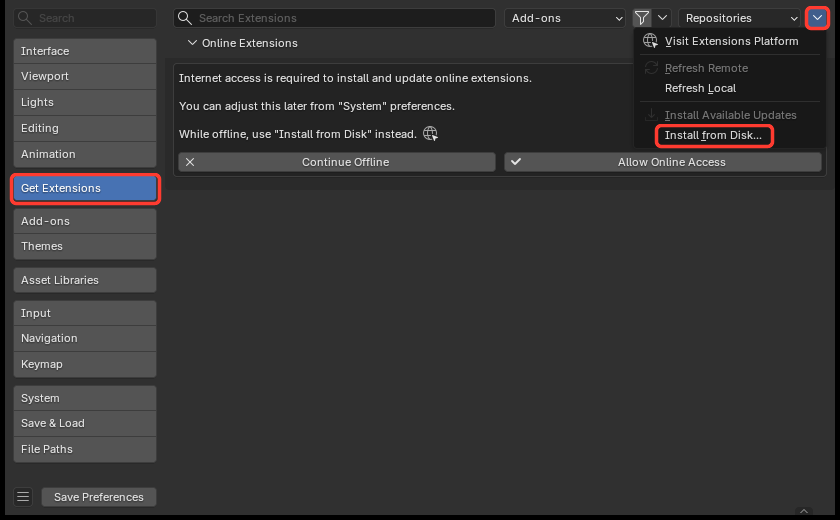
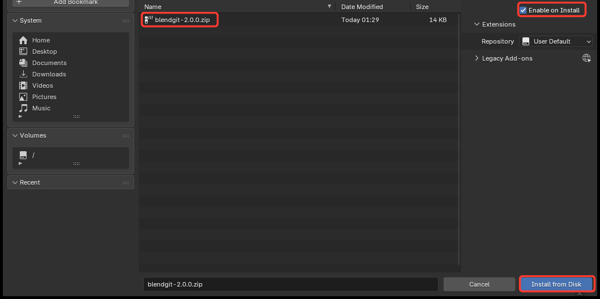
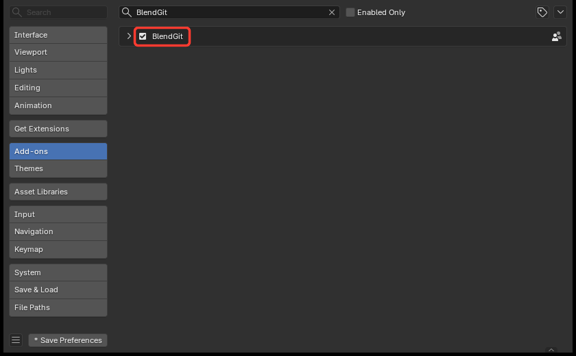
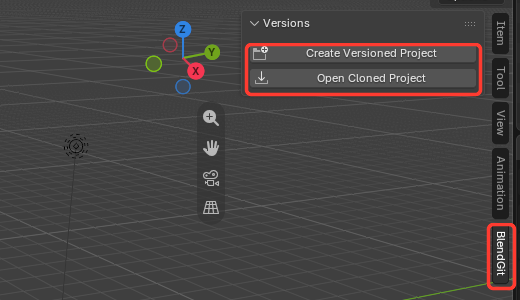
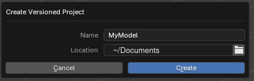
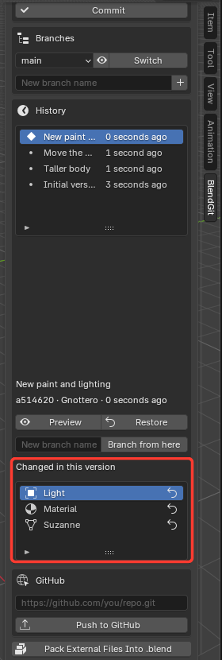

# Installing BlendGit

This takes about five minutes. You need:

- **Blender 5.0 or newer.** BlendGit has been tested on Blender 5.2.3.
- **Git.** Get it from [git-scm.com](https://git-scm.com/downloads) if you don't have it. To check, open a terminal and run `git --version`.
- **The add-on file**, `blendgit-<version>.zip` (for example `blendgit-2.0.0.zip`). Don't unzip it, Blender reads it as it is.

If you only have the source code, you can build the zip from the project folder:

```sh
mkdir dist
blender --command extension build --source-dir blendgit --output-dir dist
```

## 1. Open the install menu

In Blender, go to **Edit → Preferences** and click **Get Extensions**. Then click the small **⌄** arrow in the top right corner and choose **Install from Disk…**

You can ignore the "Allow Online Access" message. BlendGit installs from your disk, so you don't need it.



## 2. Pick the zip

Find the zip, select it, and make sure **Enable on Install** is ticked. Then click **Install from Disk**.



## 3. Check that it's enabled

Click **Add-ons** on the left and search for `BlendGit`. The box next to its name should be ticked.



## 4. Open the sidebar

Close Preferences. Move your mouse over the 3D View and press **N** to open the sidebar, then click the **BlendGit** tab on its right edge. You should see two buttons:



That's it, BlendGit is installed.

## 5. Create your first project

Click **Create Versioned Project**, give it a name and a location, and click **Create**.



BlendGit makes a new folder, copies your model and every file it uses into it, and records the first version. Your original files stay where they are.

From now on, write a message and click **Commit** whenever you want to save a version. Pick a version in **History** to see what changed in it. The arrow next to an item rolls back only that item:



## Opening a project from GitHub

GitHub stores your project as separate pieces, so a fresh clone doesn't have a `.blend` to double click yet. In Blender, open the BlendGit tab, click **Open Cloned Project**, and pick the cloned folder. BlendGit rebuilds the `.blend` and opens it.

## Updating from BlendGit 1.0

Install the new zip the same way. Your projects update themselves on the next commit: old versions stay in the history as they are, and new ones are stored as pieces.

Once a project has been updated, always open it in BlendGit 2.0 or newer.

## If something goes wrong

| What you see | What to do |
| --- | --- |
| Blender refuses the zip | Your Blender is older than 5.0. Update it. |
| "Git is not installed" | Install Git, then restart Blender so it can find it. |
| No BlendGit tab in the sidebar | Go back to step 3 and tick the box. |
| "You have uncommitted changes" | You saved after your last commit. Commit first, so that work isn't lost. |
| "That folder is not a BlendGit project" | Pick the folder that has `blocks` inside it. |
